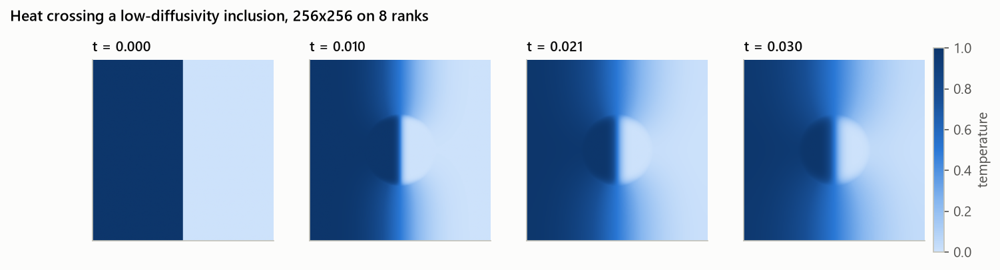
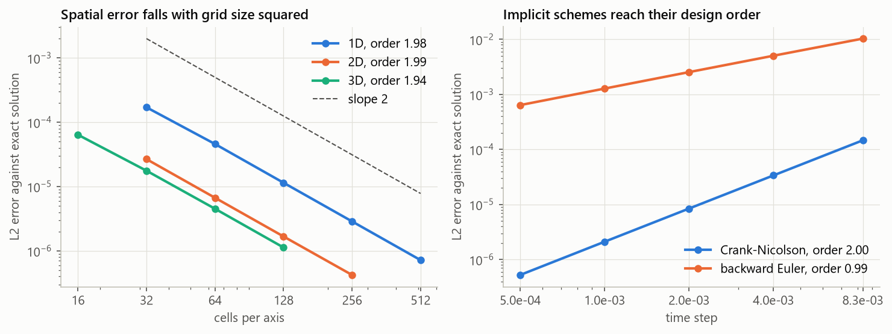
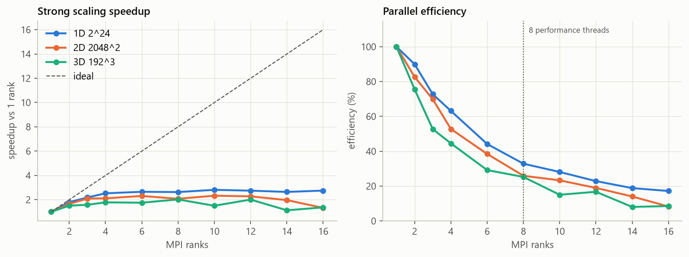
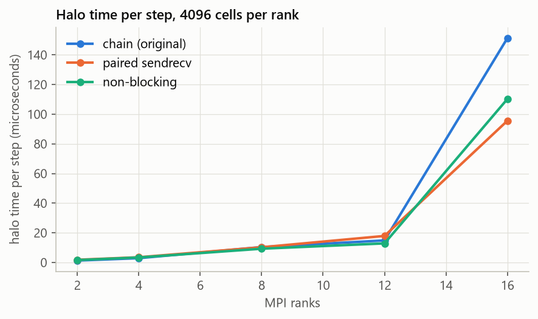
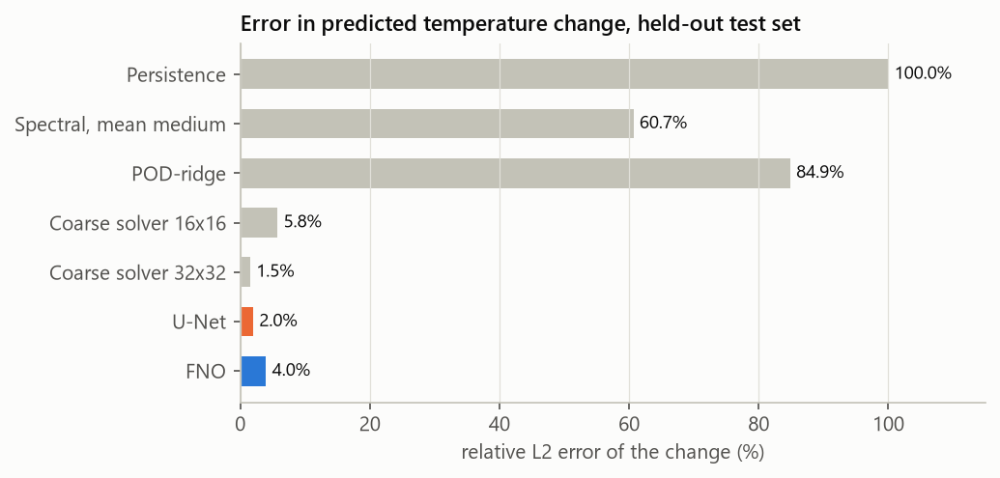
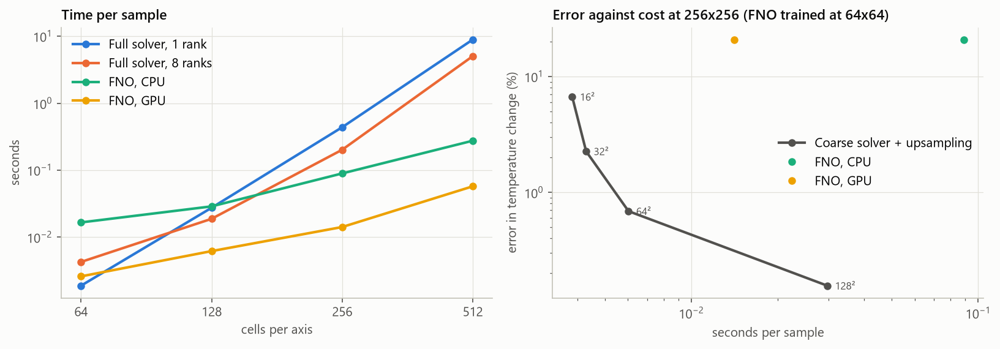
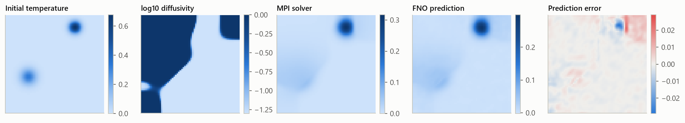

# MPI Heat Lab

[](https://github.com/jarianj/mpi-heat-lab/actions/workflows/ci.yml)

A parallel heat-equation solver in C and MPI, with a verification suite, a benchmark study, a learned runtime model, and neural surrogates trained on the solver's own output. A Streamlit dashboard runs the solver live and shows every result.

It started as a 1D MPI heat-diffusion exercise ([first two commits](https://github.com/jarianj/mpi-heat-lab/commits/main)). The question it now answers is narrower than "can it run in parallel": **is the parallel solver provably correct, where does its scaling stop and why, and when does a neural network actually beat simply running the solver on a coarser grid?**



## What is in it

| Part | What it does |
|---|---|
| `src/solver/` | C11 + MPI finite-volume solver for $\partial_t T = \nabla\cdot(\alpha\nabla T)$ in 1D, 2D and 3D. Cartesian process grid, subarray halo types, three halo strategies, explicit / Crank-Nicolson / backward Euler (preconditioned CG), variable materials, collective MPI-IO |
| `heatlab.verification` | Manufactured solutions, convergence order, bit-for-bit decomposition independence, energy conservation, an exact composite-slab steady state, and the explicit stability boundary |
| `heatlab.scaling` | Strong, weak, halo and decomposition studies in randomized order with repeats, fitted with the Universal Scalability Law |
| `heatlab.perfmodel` | Predicts time per step from 720 timed runs: a physical least-squares model against gradient boosting, validated on held-out grid sizes and rank counts |
| `heatlab.surrogate` | FNO and U-Net trained on solver data, scored against persistence, an exact spectral solve, POD-ridge regression, and the solver itself on a coarse grid |
| `heatlab.dashboard` | Live solver, verification, scaling, surrogate and runtime-planner pages |

Methods, derivations and references are in [docs/methods.md](docs/methods.md).

## Quickstart

Needs an MPI implementation (Open MPI, MPICH or MS-MPI), a C compiler and Python 3.11+.

```bash
make build                         # bin/heatsolve
pip install -e ".[dashboard,dev]"
make test                          # 49 tests
python -m heatlab dashboard        # http://localhost:8501
```

The solver also runs on its own:

```bash
mpiexec -n 8 bin/heatsolve --nx 512 --ny 512 --medium inclusion --scheme cn --cfl 10 --t-end 0.02
```

It prints one JSON line with energy, error and per-stage timings. The options are listed in `src/solver/params.c`.

With Docker: `docker build -t heatlab . && docker run -p 8501:8501 heatlab`.

Everything in `results/` can be regenerated:

```bash
python -m heatlab verify     # minutes
python -m heatlab scale      # about 15 minutes
python -m heatlab sweep      # about 30 minutes
python -m heatlab perf
python -m heatlab dataset    # solver-generated training data
python -m heatlab train      # 3 seeds per model, GPU recommended
python -m heatlab evaluate
python -m heatlab figures
```

On Windows with MSYS2, use `mingw32-make` and put `ucrt64/bin` on `PATH` before building.

## Results

All numbers come from one laptop: Intel i7-1360P (4 performance + 8 efficiency cores, 16 threads), 16 GB RAM, Windows 11, MS-MPI, GCC 15.2 `-O3 -march=native`, RTX 2050 for training. Benchmark values are medians of 5 repeats run in random order.

### The solver is correct

| Check | Result | Expected |
|---|---|---|
| Spatial convergence order, 1D / 2D / 3D | 1.98 / 1.99 / 1.94 | 2 |
| Temporal order, Crank-Nicolson / backward Euler | 2.00 / 0.99 | 2 / 1 |
| Same answer on 1, 2, 3, 4, 6, 8, 12 ranks, two halo modes, 1D-3D | 72 of 72 bit-identical (SHA-256) | identical |
| Worst relative energy drift, insulated walls | 3.5e-12 | round-off |
| Composite slab, max error against exact steady state | 2.3e-12 | round-off (harmonic face mean makes it exact) |
| Explicit stability boundary | stable at CFL 1.00, diverges at 1.01 | 1.00 |



### Scaling stops early on a laptop, and the reason is measurable

| Problem | Best speedup | At ranks | Halo share of time at 16 ranks |
|---|---|---|---|
| 1D, 2^24 cells | 2.8x | 10 | 21% |
| 2D, 2048² | 2.3x | 6-10 | 72% |
| 3D, 192³ | 2.0x | 8-12 | 61% |

The stencil does almost no arithmetic per byte, so a few ranks saturate the memory bus. Weak-scaling efficiency drops to 42% at 4 ranks and 5% at 16, the signature of a shared memory bandwidth limit, not of communication. Past 12 ranks the solver runs on hyperthreads and slow cores, and the halo exchange becomes the slowest rank waiting for the others.

Two design choices still matter a lot inside that limit:

- **Decomposition shape.** For 192³ on 8 ranks, a 2x2x2 block takes 1.86 s and an 8x1x1 slab takes 3.81 s. At 12 ranks the block is 2.3x faster. The block exchanges far fewer halo cells.
- **Halo strategy.** On 2D 1024² at 16 ranks, non-blocking overlap takes 0.88 s against 1.49 s for the original program's chain pattern.





### A runtime model that explains the ceiling

Two models predict the time per step from 720 timed runs (240 configurations × 3 repeats). Each is tested on a grid size or rank count it never saw.

| Model | Error, unseen grid size | Error, unseen rank count |
|---|---|---|
| Analytic least squares (4 physical terms) | 38% | 38% |
| Gradient boosting | 35% | 43% |

Mean absolute percentage error. Repeat-to-repeat noise alone is 17%, so neither model can do much better on this machine.

The analytic model is the more useful one. It fits 0.40 ns per cell for work private to a rank and 0.25 ns per cell for traffic on the shared memory bus. That implies a speedup ceiling of $(0.40 + 0.25) / 0.25 \approx 2.6$ before any communication, which matches the measured 2.0-2.8x. A first version without the shared-bus term had 53% error. Its main remaining weakness is the cache: it charges one cost per cell, so it predicts 2.7 ms per step for 2048² on one rank against a measured 5.7 ms. The dashboard's planner page uses both models to recommend a rank count.

### The neural surrogates lose to a coarse solver

The task: given an initial temperature and a material map on the insulated unit square, predict the temperature at $t = 0.02$. Training data are 1,600 solver runs at 64². Errors are on the 300-sample test set, measured on the temperature *change*, so "predict no change" scores 100%. Neural results are means over 3 training seeds, with ± the standard deviation across seeds in percentage points.

| Method | Test error | Shifted-data error | Energy drift |
|---|---|---|---|
| Persistence (no change) | 100% | 100% | 0 |
| Exact spectral solve, averaged material | 61% | 92% | 0 |
| POD-ridge regression | 85% | 221% | 0 |
| **Coarse solver 32², upsampled** | **1.5%** | **6.0%** | 0 |
| U-Net (1.95M parameters) | 2.0% ± 0.02 | 42% | 0 (conservative) |
| FNO (2.37M parameters) | 4.0% ± 0.09 | 31% | 0 (conservative) |



Both networks learn the problem well: 2-4% error, against 61% for the best non-solver baseline. But simply running the solver on a 32² grid is more accurate and takes about 1 ms. The networks fall further behind on the shifted set, which has 100x material contrast and finer features than anything in training. There the coarse solver reaches 6% and the best network 31%.

Advertised strengths of neural operators did not hold up here either:

- **Resolution transfer.** The FNO trained at 64² has 16% error at 128² and 21% at 256². For a 256² target, the coarse solver at 64² gives 0.7% error in 6 ms.
- **Speed.** At 512² the FNO on the GPU takes 57 ms, against 5.0 s for the full solver on 8 ranks. That ratio only means something if the accuracy were comparable, and it is not.
- **Physics.** Without correction, the FNO's energy drifts by 0.4% on test data and 32% on shifted data. Subtracting the mean predicted change makes energy conservation exact at no cost in accuracy, so both networks in the table use that.



Solver times are the solver's own wall clock, excluding MPI process launch. Network times are measured inference with batch size 1.

The conclusion is a negative result for this problem. A surrogate for the linear heat equation has to beat a coarse-grid solve, not just the full-resolution one, and these two do not. They would be worth it for an expensive solver (nonlinear, stiff, or 3D at high resolution) or as a building block in a larger learned system. This repository is a reproducible setup for testing that claim.



## What the original program got wrong

The starting code is kept in the history. Two defects shaped the verification suite:

1. **Nothing diffused.** The initial temperature was uniform, so the printed `T_average: 1.000000` could not reveal a conservation bug.
2. **Cells were dropped.** The local size was `grid_size / num_procs`. On 3 ranks with 1024 cells one cell was lost and the average printed as `0.999023`. The new partition gives every rank $\lfloor n/P \rfloor$ or $\lceil n/P \rceil$ cells, and the decomposition test checks every rank count bit for bit.

The original's left-then-right blocking exchange is kept as the `chain` halo mode so its cost can be measured. It deadlocks on a periodic domain, so the solver refuses that combination.

## Limitations

- All performance results are from one shared-memory laptop. A cluster with a real interconnect would show a different balance between memory bandwidth and communication.
- The runtime model is fitted to this machine and only predicts it.
- The surrogate learns one problem: insulated unit square, fixed end time, 64² training grid. It does not generalize to other boundaries or times.
- Implicit schemes use Jacobi-preconditioned CG. Multigrid would scale better for large stiff problems.

## Repository layout

```
src/solver/        C solver
src/heatlab/       Python package: verification, scaling, perfmodel, surrogate, dashboard, figures
tests/             pytest suite (solver, surrogate, dashboard)
results/           generated JSON and CSV results
reports/figures/   generated figures
models/            trained FNO checkpoint used by the dashboard
docs/methods.md    methods and references
```

## Acknowledgements

The original 1D solver is my own work. I extended it into this project with substantial help from an AI coding assistant, and I have reviewed and run everything reported here.

## License

MIT
